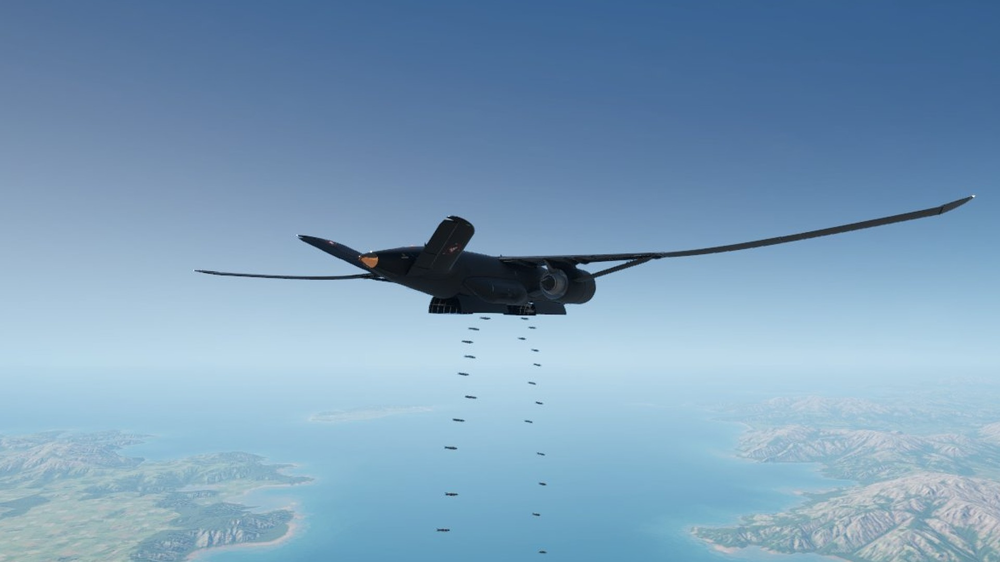
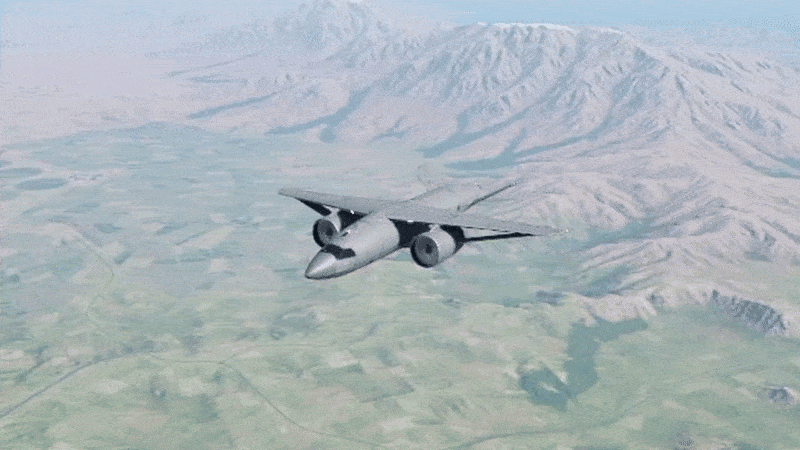
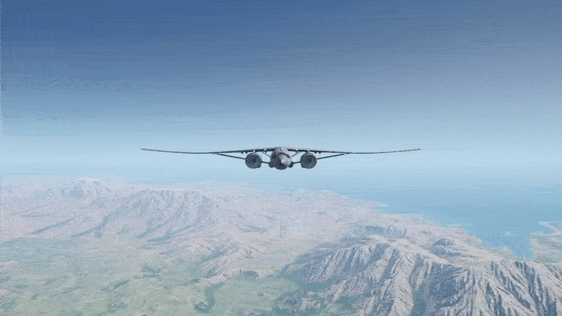
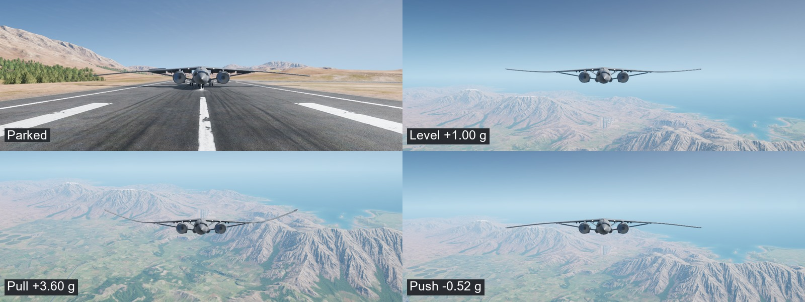
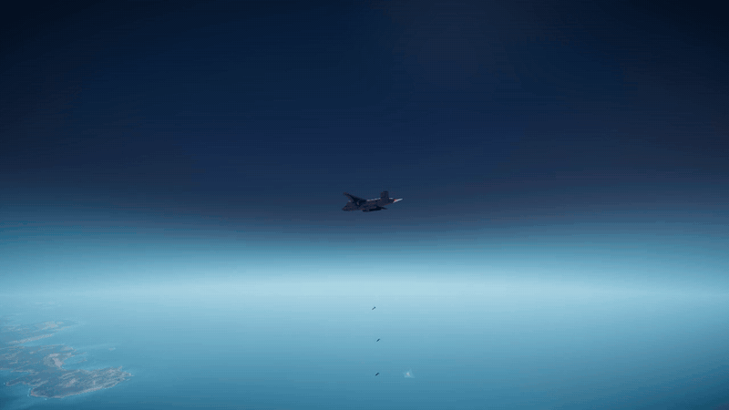
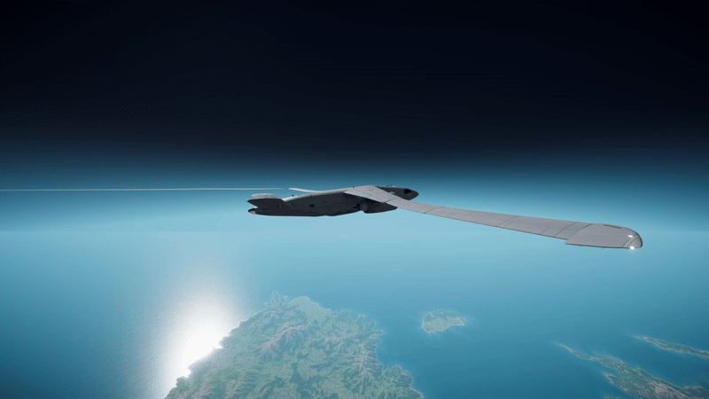

# MRB-100 Centurion

A 2080s heavy bomber and AWACS for Nuclear Option, built as a successor to the B-52. Its truss-braced wing doubles in span once clear of the hangar, two internal bays carry up to 50 tonnes of ordnance, and a tail laser defends the rear arc while nose, tail and dorsal radars run together. Both factions can spawn it from any base with a medium hangar.

Every player in a multiplayer lobby needs the mod installed, as new aircraft are never client-side.

[Pilot's guide](docs/player/FLYING.md) | [Known issues](docs/player/KNOWN-ISSUES.md) | [Changelog](CHANGELOG.md)

## Install

Requires BepInEx 5 and [Blueprinter 2.0.1 or later](https://github.com/nikkorap/NOBlueprinter-Releases/releases). Version 0.2.0 was tested on Nuclear Option 0.34.6 with Blueprinter 2.1.1. Keep Blueprinter enabled.

### With NOMM

Install [Nuclear Option Mod Manager](https://github.com/Combat787/NOMM/releases/latest), point it at your game folder, then search the catalog for **MRB-100 Centurion** and install it.

If BepInEx 5 is not installed yet, NOMM installs it first. Let that finish, then retry installing the mod if needed. Catalog installation also pulls in Blueprinter. Check that Blueprinter is enabled and at least version 2.0.1, because NOMM does not enforce minimum dependency versions.

### Manual installation

1. Close Nuclear Option. Install [BepInEx 5 for Windows x64](https://github.com/BepInEx/BepInEx/releases/tag/v5.4.23.4) in your game folder beside `NuclearOption.exe`.
2. Put `Blueprinter_2.0.1.dll` or a later compatible version from [Blueprinter releases](https://github.com/nikkorap/NOBlueprinter-Releases/releases) into `BepInEx/plugins/`.
3. Download `Centurion-v<version>-plugin-only.zip` from [Centurion releases](https://github.com/baanish/MRB-100-Centurion/releases) and extract it beside `NuclearOption.exe`. This creates `BepInEx/plugins/baanish.centurion/` containing `Centurion.dll`, `centurion_<version>.nobp`, `meta.json`, this README and the licence. Keep the DLL and bundle in the same folder.
4. Launch the game. `BepInEx/LogOutput.log` should include `MRB-100 Centurion <version> (baanish.centurion)`, and the Centurion will appear at bases with a medium hangar.

To update manually, close the game and replace `BepInEx/plugins/baanish.centurion/`, deleting the old `.nobp` bundle. Keep only one copy installed. To uninstall, delete that folder. NOMM users can update, disable or remove the mod directly from their library.

## At a glance

| | |
|---|---|
| Role | Heavy bomber, or AWACS with the dorsal radar beam fitted |
| Cost and rank | $500M, rank 6 |
| Length | 147 ft (44.95 m) |
| Wingspan | 143 ft (43.56 m) retracted, 286 ft (87.14 m) extended |
| Height | 24.6 ft (7.51 m), clearing the medium hangar's 8 m door |
| Mass | 125 t empty, 24 t internal fuel, 50 t payload, 199 t maximum takeoff |
| Engines | Two geared turbofans, 330 kN each, no afterburner |
| Radar cross-section | 13 retracted, 26 extended on the game's radar scale |
| Ceiling | 55,000 ft official (about 57,500 ft extended at mid weight, about 46,000 ft retracted) |
| Speed | Near Mach 0.85 retracted; drag holds level flight near Mach 0.81 extended |
| Endurance | About 3.3 hours of AWACS loiter to 20% internal fuel, excluding climb and manoeuvring |
| Crew | Two (pilot and mission commander) with separate ejection seats |
| Liveries | BDF Matte Gray and Forest Green; PALA Matte Black and Desert Camo |

Nuclear Option has no aerial refuelling, so internal fuel is all you have.

## Flying the telescoping wing

Bind wing span to **Custom Axis 1**, the same axis the Alkyon uses for wing sweep. Zero is retracted, full is extended, and full travel takes 8 seconds.

- **Retract to go fast.** With the wing in, you can cruise and dash near Mach 0.85. Extended drag climbs hard past Mach 0.76, so pull the wing in above Mach 0.75.
- **Extend to climb and loiter.** Full span buys you lower fuel burn, a higher ceiling and slower, gentler turns.
- **Taxi with the wing in.** On the ground within about 100 m of a medium hangar, the span locks retracted so it cannot clip the building. Wait for the hangar doors to open completely before rolling, because the retracted tips clear the doorway by only 3.6 ft a side.
- **Heavy takeoffs work at either span.** Flaps set themselves to 30 degrees for takeoff and 15 degrees for landing, stowing slowly over 20 seconds after gear up so you do not sink during the climb. Rotate to 8 or 9 degrees. The tail strikes at 10.5.
- **Mind the g-limit.** Past 25% extension, holding more than +4 g or less than -1 g for half a second tears both outer stages off and locks the mechanism for the rest of the sortie. Losing one outer panel to enemy fire automatically jettisons the healthy opposite outer panel to keep lift balanced. Losing a whole wing at its root does not. A torn wing adds permanent drag, so throttle back and head home.

Full takeoff, landing, flap and damage procedures live in the [pilot's guide](docs/player/FLYING.md).

## Wing flex

A 286 ft wing bends noticeably under load, and the Centurion's does. The braced inner wing stays stiff while everything outboard of the strut bends together on a spring and damper, so the tips lag a sudden pull and sway after a gust or touchdown. Because flex scales with the cube of the outer span, the retracted wing barely moves while the extended wing bows sharply. Near the runway, the bend fades to ground droop so wingtip clearances match the solid airframe.

| Flight state (fully extended) | Tip offset |
|---|---|
| Parked, under its own weight | 2.5 ft (0.75 m) down |
| Level flight, 1 g | 8 ft (2.5 m) up |
| Hard pull, 3.6 g | 24 ft (7.2 m) up |
| Near the 4 g tear limit | 25 ft (7.5 m) up |
| Push, -0.5 g | 5.5 ft (1.7 m) down |

Wing flex is purely visual and does not affect flight physics or colliders. You can tune or disable it under `[WingFlex]` in [Settings](#settings).

## Bomber

Two internal bays, forward and aft, carry up to 50 t of ground-attack ordnance between them. Identical munitions in both bays pool into a single weapon selection. Single bomb drops alternate bays. Holding the trigger, or designating two or more targets, releases from both bays at once at that bomb's normal interval. Bay doors stay open for four seconds and lower layers drop first.

Standard totals across both bays (see the [pilot's guide](docs/player/FLYING.md) for per-bay counts, smaller racks, event-content LEGACY racks and optional weapon pack racks):

| Munition | Rounds |
|---|---|
| PAB-250 | 120 |
| PAB-250LR | 120 |
| PAB-80LR | 264 |
| GPO-500 | 66 |
| GPO-N (1.5 kt), GPO-N (250 kt) | 28 each |
| GBM-500LR | 54 |
| Tusko-B (HE) | 42 |
| AShM-300 | 36 |
| AGM-99 | 56 |
| ALM-C450 | 21 (12 forward, 9 aft) |
| ALND-4 (20 kt) | 10 |
| GPO-2P Auger | 18 |
| Piledriver TBM, Piledriver TBM (20 kt) | 12 each |
| Demolition Bomb | 4 |
| ARAD-116 | Forward bay only (4, 8 or 16) |

In missions that allow event content, the older 0.1.3 rack sizes are still available under `LEGACY` labels. The 412-round LEGACY PAB-80LR pair weighs 51.5 t and reaches 200.5 t with full fuel and the laser fitted, so drop fuel to 93% or less to stay under 199 t.

If you also have the Aryx Weaponry Pack or Meridian Works installed, the bays offer Centurion-sized racks for their weapons automatically. Nothing from either pack ships with this mod, and everyone in a multiplayer lobby needs the same packs.

The Centurion carries no air-to-air missiles and no external pods. Its built-in ECM is strictly defensive and does not replace an offensive Radar Jamming Pod.

### Bay cook-off

Each weapon bay sits under a fuselage fuel tank. If that tank burns for 20 seconds while conventional ordnance is still aboard, the bay cooks off in a single blast scaled to the remaining stores (up to 5,000 kg of TNT) and blows that section of the aircraft apart. Nuclear weapons never cook off. If a tank catches fire, you have 20 seconds to dump the bay beneath it.

## AWACS

Fit the 6 t dorsal radar beam to turn the Centurion into an airborne radar platform. The Wedgetail-style beam stows flat in a spine well so the aircraft still fits inside medium hangars.

- Clear of the hangar with radar master on, the beam rises and extends its ends over 12 seconds. It does not detect targets until fully up.
- Nominal range is 150 km in every direction, running alongside the 60 km nose radar and 40 km tail radar (both 60-degree half-cones). All three radars share the stock radar toggle, and switching radars off stows the beam to shed its drag.
- The beam takes the aft bay's volume, so the aft bay stays empty. The forward bay keeps its options, including ARAD-116 racks (16 rounds on the AWACS preset).
- Deployed, the beam draws 15 kW from the capacitor, adds real drag and lights you up to enemy RWRs and anti-radiation missiles. Typical AWACS loiter is around 49,000 ft at about 390 kt with the wing extended.

## Laser C-RAM

The tail cone houses a 120 kW defensive laser with an 8 km range and an 80-degree aft cone. It draws from a 2,000 kJ capacitor charged by the engines, shared with the radars and built-in ECM.

- **Automatic defence.** Whenever another weapon is selected, the laser automatically engages tracked hostile missiles aimed at you, aimed at friendlies, or flying untargeted. It never fires on aircraft or ground units on its own.
- **Manual aim.** Select the laser station to aim it yourself with your view or on a designated target (aircraft and ground units included). It burns whatever sits first along the beam, friendlies included, and pauses automatic defence while selected. Switch back to another weapon to return it to automatic mode. If both bays are empty, the laser defends automatically until you hold the trigger to aim it, then resumes automatic defence when you let go.
- **Limits.** It stops single missiles from behind while the capacitor has charge, not salvos, head-on shots or cannon fire. Built-in ECM doubles its effective jamming against active and semi-active radar missile seekers without changing search radar returns, and flares work as on the Darkreach.
- **Removable.** Leaving the laser station empty saves 300 kg and removes the defence, though the tail dome stays.

## Controls and HUD

The mod uses Nuclear Option's existing bindings and adds no new hotkeys.

| Action | Input |
|---|---|
| Wing span | Custom Axis 1 |
| Radars and AWACS beam | Stock radar toggle |
| Laser C-RAM | Automatic when another weapon is selected; select its station (or hold the trigger with empty bays) to aim manually |
| Flares and ECM | Stock countermeasure controls |
| Airbrakes | Throttle at idle (split ailerons and spoilers) |

In the cockpit and on the HUD, you get a dedicated span gauge (`SPAN 0%` to `SPAN 100%`) with a commanded-span marker, a matching live wing display left of the flight display, a 100% throttle gauge with no afterburner range, a tactical screen covering both engines and all four hardpoint sets, and a top-down Centurion damage diagram.

## AI

AI Centurions fly high-altitude bomber and AWACS profiles instead of the stock low-level strike pattern.

- **Bombers** climb out extended near home before cruising at 51,000 to 57,000 ft by weight in gentle 20-degree banks, coming in lower against targets close to their base (from 15,000 ft at 10 nautical miles up to 50,000 ft at 30 nautical miles for bombs, and 20,000 ft within 22 nautical miles for missiles). They pick from eight loadouts, switching bomb loads to Tusko-B or AShM-300 missiles whenever an enemy long-range SAM is alive, and firing early during the climb if a long-range SAM covers their home base. They stay on an assigned target until it is destroyed, hold steady when the laser can intercept an incoming missile, and dodge radar missiles laterally without diving to the deck.
- **AWACS** climbs to about 49,000 ft and flies a racetrack near the front, standing off roughly 25 km from the nearest enemy base so it can spot stealth fighters, and heads home at 20% fuel. It fires pairs of ARAD-116s at emitting hostile SAM and AA radars from outside their reach plus 10 km, one pair in flight at a time.

AI Centurions require a runway of at least 6,257 ft (1,907 m) to take off. Players can spawn at any base with a medium hangar. In stock Domination, Escalation, Terminal Control and their co-op variants, one BDF factory alternates building Centurions and Darkreaches (BDF starts with none). Hosts can turn that off in the config below.

## Settings

Edit `BepInEx/config/baanish.centurion.cfg`, or adjust these in game with Configuration Manager:

| Setting | Default | What it does |
|---|---|---|
| `WingFlex.Enabled` | true | Bend the drawn wing under load (cosmetic) |
| `WingFlex.TipRise1gM` | 2.5 | Tip rise at 1 g, metres |
| `WingFlex.TipRiseAtTearM` | 7.5 | Tip rise near the 4 g tear limit, metres |
| `WingFlex.GroundDroopM` | 0.75 | Tip droop parked, metres |
| `Cram.CoverEscorts` | true | Engage missiles aimed at friendlies too; keep this identical across a multiplayer lobby |
| `Missions.StockMissionSupply` | true | Have one BDF factory alternate Centurions and Darkreaches in stock Domination, Escalation, Terminal Control and co-op variants (host setting, applies on next mission load) |

In Configuration Manager, the seven `[WingFlex]` tuning parameters (including `FrequencyHz`, `DampingRatio`, `ReferenceSpanM` and `SpanExponent`) appear when **Advanced settings** is ticked. Upgrading to 0.2.0 automatically strips the old 0.1.x `Diagnostics`, `Debug` and `Capture` config sections while keeping your other settings.

## Paint your own livery

Download `centurion_livery_kit_<version>.zip` from the [Releases page](https://github.com/baanish/MRB-100-Centurion/releases). The [livery kit guide](docs/livery-kit/README.md) walks through painting the 3D model or flat templates, building the livery in Unity and installing it. Wing sections, nacelles and outboard flaps paint independently on left and right, and Steam Workshop liveries use the tag `MRB-100 Centurion`.

## Known limitations

Pre-release builds on the [Releases page](https://github.com/baanish/MRB-100-Centurion/releases) are work in progress.

- **Battle damage art is not final.** Damage openings, internal structure and broken-up sections are still being finished.
- **Multiplayer requirements.** Every player in a lobby needs the mod, Blueprinter enabled, and the same weapon packs if any are installed.
- **Dedicated server manual laser aim.** Select a target before firing the laser manually on a dedicated server. Free aim with no target selected may not match where the server applies damage.
- **Avoid 4x time acceleration while manoeuvring.** High time compression can cause load spikes that tear off the outer wing stages.
- **Game version.** Built for Nuclear Option 0.34.6, and not tested on 0.35 or later.

See [known issues](docs/player/KNOWN-ISSUES.md) for the full list and bug-reporting instructions, or open a report on [GitHub issues](https://github.com/baanish/MRB-100-Centurion/issues) with your game version, mod version, other mods, reproduction steps and `BepInEx/LogOutput.log`.

## Credits

- Made by baanish, with Claude Opus and GPT. Contributions of human-made art are welcome.
- [Blueprinter](https://github.com/nikkorap/NOBlueprinter-Releases) by nikkorap; separate download. Blueprinter Unity template copyright 2026 Nikkorap, MIT License.
- Nuclear Option and its content belong to Shockfront.
- [BepInEx](https://github.com/BepInEx/BepInEx) and [Harmony](https://github.com/pardeike/Harmony) load and patch the plugin; neither ships with it.
- Engine recordings and other sound credits are listed in [audio/CREDITS.md](audio/CREDITS.md).
- Design references: Boeing's transonic truss-braced wing studies (X-66), the E-7 Wedgetail's beam, and Rolls-Royce's UltraFan.

## Licence

MIT; see [LICENSE](LICENSE).

## Releasing

Maintainers need the local Unity and game setup in [BUILD.md](BUILD.md). Run `pwsh -NoProfile -File tools/Package-Release.ps1` to build, verify and package a release with notes and its NOMNOM manifest, then follow [the release procedure](docs/RELEASE.md) to publish it. GitHub Actions verifies uploaded assets after publication.
