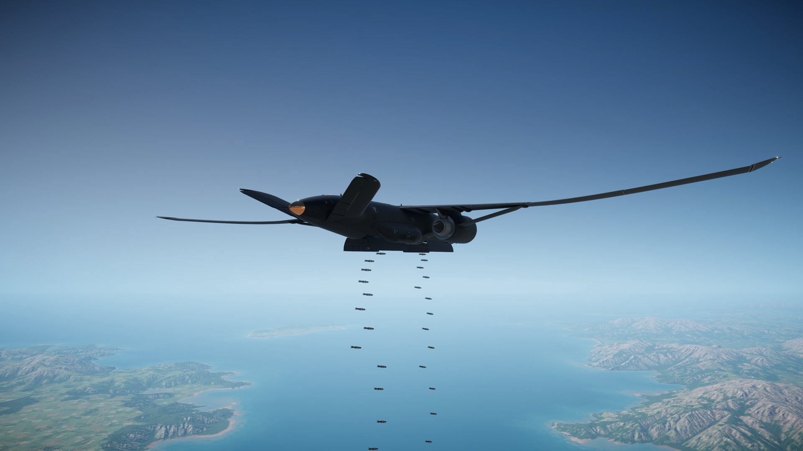
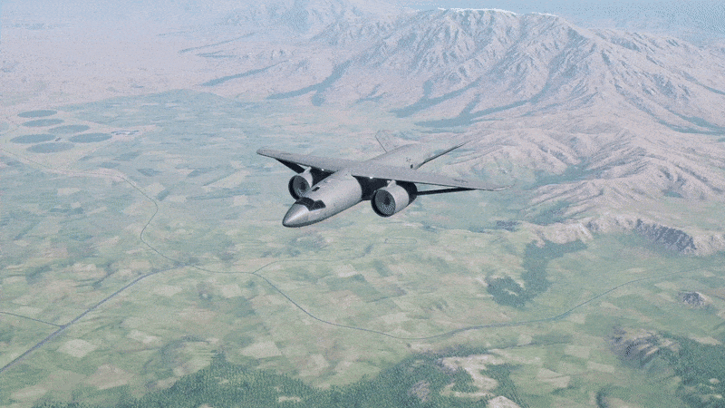

# MRB-100 Centurion

A heavy bomber and AWACS for Nuclear Option 0.34.2, set in the 2080s as the B-52's successor. Its truss-braced wing telescopes from hangar width to twice that in flight, two late-UltraFan turbofans charge a capacitor for a laser C-RAM in the tail, and nose, tail and dorsal radars all run at once. It spawns from medium hangars for both factions.

Every player in a lobby needs the mod: a new aircraft is never client-side.

## Install

Requires Nuclear Option 0.34.2, BepInEx 5 and [Blueprinter 2.0.1 or later](https://github.com/nikkorap/NOBlueprinter-Releases/releases). Keep Blueprinter enabled.

### With NOMM

Install [Nuclear Option Mod Manager](https://github.com/Combat787/NOMM/releases/latest), select your game folder, then search its catalog for **MRB-100 Centurion** and install it. The entry becomes available after its first [NOMNOM listing](https://github.com/KopterBuzz/NOMNOM) is accepted. Until then, use the manual installation below.

NOMM installs BepInEx 5 if it is missing. Let that finish, then retry the mod installation if necessary. Catalog installation also downloads Blueprinter. NOMM reports missing or disabled dependencies and offers to resolve them. Confirm Blueprinter is enabled and at least version 2.0.1: NOMM's dependency checks do not enforce the minimum version.

### Manual installation

1. Close Nuclear Option. Install [BepInEx 5 for Windows x64](https://github.com/BepInEx/BepInEx/releases/tag/v5.4.23.4) in the game folder, beside `NuclearOption.exe`.
2. Put `Blueprinter_2.0.1.dll` or a later compatible version from [Blueprinter releases](https://github.com/nikkorap/NOBlueprinter-Releases/releases) in `BepInEx/plugins/`.
3. Download `Centurion-v<version>-plugin-only.zip` from [Centurion releases](https://github.com/baanish/MRB-100-Centurion/releases) and extract it beside `NuclearOption.exe`. It creates `BepInEx/plugins/baanish.centurion/` containing `Centurion.dll`, `centurion_<version>.nobp`, `meta.json`, this README and the licence. Keep the DLL and bundle together.
4. Launch the game. `BepInEx/LogOutput.log` should contain `MRB-100 Centurion <version> (baanish.centurion)`. The aircraft appears at bases with a medium hangar.

To upgrade manually, close the game and replace `BepInEx/plugins/baanish.centurion/`, removing the old bundle. To uninstall, delete that folder. Keep only one copy installed. NOMM users can update, toggle or uninstall the whole mod in their library.

## At a glance

| | |
|---|---|
| Role | Heavy bomber, or AWACS with the dorsal beam fitted |
| Cost, rank | $500M, rank 6 |
| Length | 44.95 m (147 ft) |
| Span | 43.56 m (143 ft) retracted, 87.14 m (286 ft) extended |
| Height | 7.51 m (24.6 ft), under the medium hangar's 8 m door |
| Mass | 125 t empty, 24 t internal fuel, 50 t payload, 199 t maximum takeoff |
| Engines | Two geared turbofans, 330 kN each, no afterburner |
| Radar cross-section | 1.5 retracted, 2.0 extended, on the game's radar scale |
| Ceiling | 55,000 ft official; extended, 17.5 km (about 57,500 ft) at mid weight; retracted, about 14 km (46,000 ft) |
| Speed | Retract for fast transit near Mach 0.85; extended, drag holds level flight near Mach 0.81 |
| Endurance | About 3.3 hours of AWACS loiter to 20% fuel, extrapolated from four burns totalling 25 minutes at 15 km and 200 m/s; excludes climb and manoeuvring |
| Crew | Two, pilot and mission commander, with separate ejection seats |
| Liveries | BDF Matte Gray and Forest Green; PALA Matte Black and Desert Camo |

No aerial refuelling: the game refuels only on the ground, so endurance is internal fuel.

## Interim builds

Builds on the [Releases page](https://github.com/baanish/MRB-100-Centurion/releases) marked **pre-release** are work in progress. The flight deck interior art and the damage model are still being finished. Check each release's notes before installing.

Read the [pilot's guide](docs/player/FLYING.md), [known issues](docs/player/KNOWN-ISSUES.md) and [changelog](CHANGELOG.md). Report problems through [GitHub issues](https://github.com/baanish/MRB-100-Centurion/issues), with your game and mod versions, other mods, steps to reproduce and `BepInEx/LogOutput.log` attached.

## Flying the telescoping wing

The span is on **Custom Axis 1**, the axis the Alkyon's wing sweep uses: 0 is retracted, full is extended, and full travel takes 8 seconds. Bind it in the game's control settings.

- **Retracted** is for speed: transit and dashes near Mach 0.85.
- **Extended** is for lift and endurance: more lift, far lower fuel burn, a higher ceiling, and a slower roll. Its drag climbs steeply above Mach 0.76, so above about Mach 0.75 retracting is the better choice.
- **Heavy takeoffs work at either span.** The automatic takeoff flaps let a fully loaded Centurion lift off retracted too. Taxi with the wing in; extend on the runway for more lift in the climb. With the current engines, a measured extended takeoff at about 199 t lifted off at 154 kt after about 920 m (3,020 ft). Leave room for weight, runway and flying technique.
- **The flaps set themselves**: 30 degrees for takeoff, 15 for landing. Slow on the ground, the next roll is a takeoff; once the flaps have stowed in flight, the next gear-down is a landing. After gear up they stow slowly, over 20 seconds, so the climb doesn't lose its lift at once. Raise the gear after takeoff: if you never do, the flaps stay at 30 degrees into the landing, which floats and can bounce.
- **Near the hangar the wing stays in.** On the ground within about 100 m of a medium hangar the span is held retracted, so a wingtip can't reach the building.
- **The wing can tear.** Extended past 25%, a load factor above +4 g or below -1 g held for half a second tears both outer stages off. The aircraft flies on at the reduced span, and the extension is locked for the rest of the sortie. At ordinary speeds a hard pull bleeds airspeed long before it gets there. Losing one outer panel to damage triggers an automatic symmetric emergency jettison of the healthy outer panel to prevent asymmetric lift. The damaged wing permanently adds drag; slow down and head home.
- **Rotation and tail strike.** Rotate to 8 or 9 degrees; the tail strikes at 10.5.
- **Hands-off pitch.** With the stick centred, the aircraft holds the flight path you released it on (level if you let go within half a degree of level). Past 60 degrees of bank, in the flare, and under AI control the stock attitude hold flies alone.
- **Airbrakes** open at exactly idle throttle, as on stock aircraft: the ailerons split and the spoilers rise.
- The wing bends with load, purely for looks: about 2.5 m (8 ft) of tip rise at 1 g and 0.75 m (2.5 ft) of droop parked. Colliders and aerodynamics don't move.

## Bomber

Two internal bays, forward and aft, take up to 50 t between them, except the 412-round PAB-80LR pair at 51.5 t. With the laser fitted and full fuel that pair reaches 200.5 t; use 93% fuel or less to stay under 199 t. Releases open the doors for four seconds, lower layers first. Both bays pool each weapon into one selection under its stock name. With the same bomb in both bays, single releases alternate between them; holding the trigger, or with two or more targets selected, both bays release together at that bomb's normal interval.

The Darkreach ground-attack inventory is the baseline for the bays, plus the stock bay racks. Paired totals across both bays:

| Munition | Rounds |
|---|---|
| PAB-250 | 198 |
| PAB-250LR | 174 |
| PAB-80LR | 412 |
| GPO-500 | 93 |
| GPO-N (1.5 kt), GPO-N (250 kt) | 110 each |
| GBM-500LR | 68 |
| Tusko-B (HE) | 48 |
| AShM-300 | 36 |
| AGM-99 | 110 |
| ALM-C450 | 21 (12 forward, 9 aft) |
| ALND-4 (20 kt) | 10 |
| GPO-2P Auger | 36 |
| Piledriver TBM, Piledriver TBM (20 kt) | 12 each |
| Demolition Bomb | 4 |
| ARAD-116 | Forward bay only: x4, x8 or x16 |

The Centurion carries no air-to-air missiles and no external pods; its built-in ECM is defensive self-protection. It does not jam enemy radars or replace the offensive Radar Jamming Pod. AI Centurions fly one of eight loadouts, picked evenly: Bombs 500 x93, Bombs 250 x198, Glide Bombs 250 x174, Glide Bombs 500 x68, Tusko-B x48, AShM-300 x36, Bombs 500 x16, and AWACS.

## AWACS

Fit the radar beam on the dorsal hardpoint (6 t). It's a Wedgetail-style beam in a well along the spine, stowed flat so the aircraft clears the hangar door.

- Once clear of the hangar with the radar on, the beam rises on its blade and extends its end sections over 12 seconds. It reads no range until fully up.
- Nominal range 150 km in every direction, alongside the nose and tail radars. Actual detection depends on the target and conditions. It draws 15 kW, and deployed it adds real drag.
- The radar toggle switches all three radars and stows or raises the beam with them, shedding its drag when stowed.
- The beam takes the aft bay's space, so the aft bay is empty on the AWACS. The forward bay keeps the ARAD-116 options (x16 on the preset).
- It loiters at about 49,000 ft (15 km), extended, near 200 m/s.

Radars on every Centurion: the nose radar sees 60 km ahead, the tail radar 40 km behind, both with 60-degree half-cones, and both follow the radar master switch.

## Laser C-RAM

The tail cone's back end is the laser's lens. The laser runs off a 2,000 kJ capacitor that the engines charge with RPM, and fires at 120 kW out to 8 km.

- It fires on its own at hostile missiles it can track: missiles aimed at you, at your escorts and other friendlies, and missiles with no target. It never picks aircraft or ground units on its own.
- Select its station to aim it yourself: it follows your view, or a target you designate (aircraft and ground units included), within 80 degrees of straight back, and fires on the trigger. It burns the first thing on its beam line, friendlies included. While it's selected it doesn't defend on its own; select any other weapon to hand it back.
- It kills single missiles, chiefly from the rear, while the capacitor holds charge. It's no shield against salvos, head-on shots or guns.
- Built-in ECM draws on the same capacitor. Its effective intensity doubles against ARH and SARH missile seekers; search radars and RWR estimates see the stock intensity. Flares work as on the Darkreach.
- Known limit: on a dedicated server, a player's aimed laser may damage along the server's own aim.
- Leaving the laser station empty saves its 300 kg and drops the point defence; the tail dome stays, with the same drag.

## Controls and HUD

| Action | Input |
|---|---|
| Span | Custom Axis 1 |
| Radars and the AWACS beam | The stock radar toggle |
| Laser C-RAM | Automatic; select its station to aim and fire it yourself |
| Flares and ECM | The stock countermeasure controls |
| Airbrakes | Throttle at idle |

On the HUD and in the cockpit:

- **Span gauge**, where the Alkyon shows its sweep: a half-wing plan whose stages slide out with the extension, a marker at the commanded span, and `SPAN 0%` to `SPAN 100%`.
- **Throttle gauge** reads up to 100%; there is no afterburner.
- **Tactical screen** with both engines, the top view and the four hardpoint sets (forward bay, aft bay, dorsal, laser).
- **Damage diagram** of the Centurion's own top view.

## AI

The AI flies both roles, on its own doctrine rather than the stock low strike.

- **Bomber:** it climbs out extended in a racetrack near its base until it's high enough to ingress, then cruises at its loaded ceiling (about 51,000 to 57,000 ft, by weight) in gentle 20 degree banks. Unguided bombs fall from that height; glide bombs release from range without it descending. Tusko-B and AShM-300 loads launch from that height and speed, and it stays up while its missiles are flying rather than landing with rounds aboard. It makes repeated passes until its targets are gone or it runs dry, keeps its pulls inside the wing's tear limits, and never picks the laser as a weapon. It holds its attack against missiles its laser can engage; against a radar missile the laser can't reach it dodges sideways but keeps its height.
- **AWACS:** it climbs to 15 km and flies a racetrack toward the front, standing off as far as the beam can still spot a stealth fighter over the nearest enemy base (about 25 km). It keeps its radars on, uses countermeasures against missiles close to impact, and heads home to land at 20% fuel. Its 16 ARAD-116s go in pairs at emitting hostile SAM and AA radars, only from beyond the site's own reach plus 10 km, one pair in the air at a time; it never fires air-to-air missiles.

AI Centurions take off only from runways of 1,907 m (6,257 ft) or longer; players can spawn at every base whose medium hangar fits it.

## Settings

`BepInEx/config/baanish.centurion.cfg`, or in game through the Configuration Manager mod if you have it:

| Setting | Default | What it does |
|---|---|---|
| `WingFlex.Enabled` | true | Bend the wing with load (cosmetic) |
| `WingFlex.TipRise1gM` | 2.5 | Tip rise at 1 g, metres |
| `WingFlex.TipRiseAtTearM` | 7.5 | Tip rise near the 4 g tear, metres |
| `WingFlex.GroundDroopM` | 0.75 | Tip droop parked, metres |
| `Cram.CoverEscorts` | true | The laser also engages missiles aimed at friendlies. Set it the same on every peer in a lobby |

The `Diagnostics`, `Debug` and `Capture` sections are for testing; leave them at their defaults.

## Known limitations

- **Art and sounds aren't final.** The Centurion has its own flight deck and engine audio. Interior art, displays and the damage model are still in progress, and the full sound set hasn't had its final listening pass.
- **Multiplayer is tested on one PC only.** Loopback tests with a separate client pass for the span, wing loss, radars, the AWACS beam and the laser, also under simulated lag, including players who join late; the two-PC test hasn't run. On a dedicated server a client's laser is untested. A late joiner sees a beam that is moving at its end position for up to 12 seconds.
- **Manual laser aim on dedicated servers can disagree with damage.** The server may apply damage along its own aim while the player aims manually.
- **Don't fly it at 4x time.** At the camera tool's 4x time scale, manoeuvring flight can tear the wing off. Normal speed is fine.
- **The AWACS radar gives you away.** Once deployed, it emits unless you switch the radars off; enemies can detect it, and anti-radiation missiles can home on it.
- Expect Nuclear Option 0.35 to break the mod until it's updated.

See [known issues](docs/player/KNOWN-ISSUES.md) for reporting details and current validation limits.

## Credits

- Made by baanish, with Claude Opus and GPT. Contributions of human-made art are welcome.
- [Blueprinter](https://github.com/nikkorap/NOBlueprinter-Releases) by nikkorap; separate download. Blueprinter Unity template copyright 2026 Nikkorap, MIT License.
- Nuclear Option and its content belong to Shockfront.
- [BepInEx](https://github.com/BepInEx/BepInEx) and [Harmony](https://github.com/pardeike/Harmony) load and patch the plugin; neither ships with it.
- Engine recordings and other sound credits are listed in [audio/CREDITS.md](audio/CREDITS.md).
- Design references: Boeing's transonic truss-braced wing studies (X-66), the E-7 Wedgetail's beam, and Rolls-Royce's UltraFan.

## Licence

MIT; see [LICENSE](LICENSE).

## Releasing

Maintainers need the local Unity and game setup in [BUILD.md](BUILD.md). Run `pwsh -NoProfile -File tools/Package-Release.ps1` to build, verify and package a release with notes and its NOMNOM manifest. Follow [docs/RELEASE.md](docs/RELEASE.md) to publish it and register the first release in NOMM. GitHub Actions verifies uploaded assets after publication.
